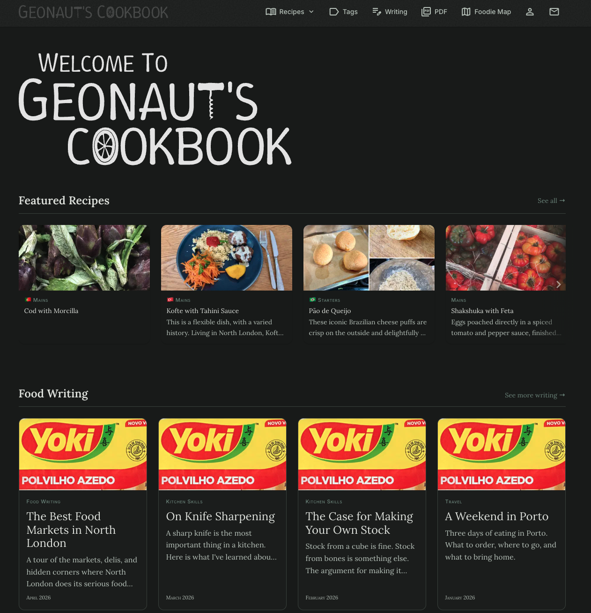

# Hugo Cookbook Theme

A [Material Design 3](https://m3.material.io/) Hugo theme for recipe collections and food writing.

Used by **[geonauts-cookbook.uk](https://geonauts-cookbook.uk/)** — see also the [cookbook source repo](https://github.com/geonaut/cookbook).



**Features:**
- Recipe index with course/cuisine filtering
- Homepage carousel of featured recipes
- Banner images with gradient overlay
- Image galleries with lightbox
- Three colour palettes (Forest, Ocean, Spice) plus custom colour override
- Dark mode via `prefers-color-scheme`
- Print-optimised recipe layout
- Shortcodes for ingredients, instructions, hints, and galleries
- Material Symbols icons
- i18n-ready

---

## Requirements

- Hugo **0.146.0+** (non-extended)
- Go **1.23+**

---

## Installation

Add as a Hugo Module. In `hugo.toml`:

```toml
[module]
  [[module.imports]]
    path = "github.com/geonaut/hugo-cookbook-theme"
```

```sh
hugo mod get github.com/geonaut/hugo-cookbook-theme
```

---

## Quick Start

Copy the `exampleSite/` directory as a starting point:

```sh
cp -r themes/hugo-cookbook-theme/exampleSite/* .
hugo server
```

---

## Content Structure

```
content/
├── recipes/
│   ├── mains/
│   │   └── my-dish/
│   │       ├── index.md   # page bundle
│   │       ├── banner.jpg
│   │       └── photo.jpg
│   ├── starters/
│   ├── desserts/
│   └── sauces/
├── writing/
├── about.md
└── contact.md
```

### Recipe front matter

```yaml
---
title: "Miso-Glazed Salmon"
date: 2024-11-12
description: "Shown in cards and meta tags."
categories: ["Mains"]   # drives index grouping and Course filter
tags: ["Japanese", "Seafood"]
featured: true           # appears in homepage carousel
banner: "banner.jpg"
thumbnail: "thumb.jpg"   # optional separate card thumbnail
---
```

Tags matching entries in `data/flags.toml` render as cuisine flag emoji.

---

## Configuration

Full example in [`exampleSite/hugo.toml`](exampleSite/hugo.toml). Key params:

```toml
[params]
  homeEyebrow    = "Welcome to"
  recipesSection = "recipes"
  writingSection = "writing"
  palette        = "forest"   # "forest" | "ocean" | "spice"

  [params.colors]
    primary  = "#1b4332"
    tertiary = "#9d0208"

  [params.fonts]
    sans       = "Inter"
    serif      = "Lora"
    url        = ""
    selfHosted = false

  [[params.utilityCards]]
    title       = "PDF Cookbook"
    description = "Download the collection as a printable PDF."
    url         = "/pdf-cookbook"
    icon        = "picture_as_pdf"
    color       = "primary"
```

### Navigation icons

```toml
[[menus.main]]
  name    = "Recipes"
  pageRef = "/recipes"
  weight  = 10
  [menus.main.params]
    icon = "menu_book"
```

---

## Shortcodes

### `recipe-grid`

```markdown

  
  - 2 salmon fillets
  
  
  1. Grill for 8 minutes.
  

```

### `hints`

```markdown

The glaze keeps for 3 days refrigerated.

```

### `gallery`

```markdown

photo-1.jpg
photo-2.jpg

```

`layout` accepts `horizontal` or `vertical`.

### `sc` (small-caps)

```markdown
serves 4
```

---

## Colour Palettes

| Palette | Character |
|---------|-----------|
| `forest` (default) | Earthy, botanical |
| `ocean` | Clean, coastal |
| `spice` | Warm, Mediterranean |

Set `params.palette = "ocean"` to switch. Custom colours: set `params.colors.primary` / `params.colors.tertiary` — dark mode values are approximated via `color-mix()`.

---

## Custom Head Content

Create `layouts/_partials/head/extra.html` in your site for analytics, extra styles, or meta tags.

---

## Self-Hosting Fonts

Set `params.fonts.selfHosted = true`, supply `@font-face` declarations via `extra.html`, and set `params.fonts.sans` / `params.fonts.serif` to match.

---

## License

MIT — see [LICENSE](LICENSE).
